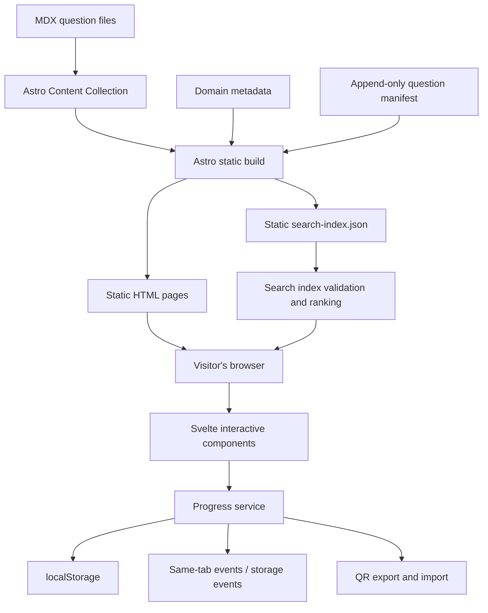

# How Frontend Atlas is put together

The short version: Astro builds the handbook into static pages. Svelte handles the bits that need
live interaction. The browser keeps learning progress. There is no application server waiting in
the wings.

I wanted to build a frontend handbook, not a platform that needs an operations rota.

## The shape of the app

The diagram is deliberately boring. Boring infrastructure is a feature.

## Build-time content, not request-time rendering

Astro is configured with `output: 'static'`. The question collection is read during the build,
validated, and used to generate the homepage, domain listings, and individual article routes.
There is no runtime content database and no server-side request handler for ordinary page views.

The content pipeline has a few guard rails:

- `src/content.config.ts` validates each question's frontmatter.
- `src/lib/content.ts` converts collection entries into the shared question-summary shape.
- `validateQuestionGraph()` checks duplicate IDs, missing relationships, self-references, duplicate
  relationships, prerequisite cycles, and the 150-question ceiling.
- `src/data/question-manifest.ts` defines the stable transport order used by progress QR exports.

The build fails when the content graph or manifest is inconsistent. I'd rather find a broken
reference during CI than have a reader click a link to nowhere.

## Astro pages and Svelte islands

Astro owns the page structure and content rendering. Svelte is used for interactive pieces such as:

- The site header, search dialog, and help dialog.
- Progress controls and progress overview.
- Reading-position tracking.
- QR export/import.
- Article navigation and notifications.

These components hydrate on the client where the page needs them. We do not hydrate the entire
handbook just to display text and links.

The UI primitives come from `@weluvabid/iris`; Tailwind CSS 4 supplies utility styling. The project
uses the Astro Svelte integration and the Tailwind Vite plugin.

## Search is a static file plus browser work

`src/pages/search-index.json.ts` creates a JSON index from the same content collection during the
static build. The search component fetches that index with an `AbortSignal`, validates its shape,
and ranks matches in the browser.

After the index has loaded, typing a query does not make another network request. Ranking is local
work over the in-memory document list. The ranker gives more weight to title, curated search terms,
tags, and summaries than to incidental mentions in article text. Typo tolerance is deliberately
limited to metadata fields to avoid turning every vaguely similar word into a result.

## Progress is a browser concern

The progress system has a shared service boundary. Components do not each invent their own storage
format or mutate `localStorage` independently.

The service reads and validates a versioned snapshot, applies a mutation, attempts persistence,
and broadcasts the result. When storage is unavailable, it can keep a volatile snapshot in memory
for the current page session. That is a fallback, not durable storage: a reload can lose it.

For the full model, persistence behaviour, merge rules, and QR portability, see
[Progress system](progress-system.md) and [QR transfer protocol](progress-transfer-protocol.md).

## Navigation and URLs

Astro's `ClientRouter` handles client-side page transitions. The shared `withBase()` helper prefixes
internal URLs using Astro's configured base path, while `questionHref()` derives article URLs from
immutable question IDs rather than loader-generated slugs.

The same build can therefore run locally at `/` and on GitHub Pages under `/frontend-atlas/`.

## Why there is no backend

The handbook does not need accounts, a user table, a progress API, a runtime database, or a cloud
sync service. Progress lives in the browser, and the QR transfer flow handles the occasional move
between devices. Search downloads one static index and does its ranking locally.

That keeps the project small enough to understand without inventing infrastructure for problems
it does not currently have. If a feature eventually needs shared server state, it can earn that
complexity on its own merits.
